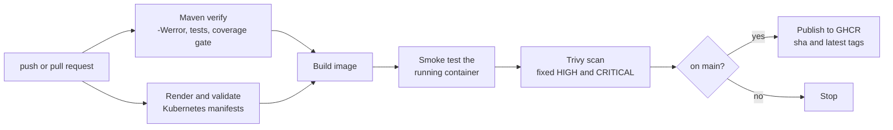

# Deployment Ledger

A small Java REST service that records deployments (what was deployed, where, and whether it worked), together with the complete CI/CD pipeline that builds, tests, scans and ships it.

The service is intentionally simple so the pipeline is the interesting part: every change is compiled with warnings as errors, tested against a coverage gate, packaged into a hardened container, smoke-tested while running, scanned for vulnerabilities and validated as Kubernetes manifests before anything is published.

## What it does

Record a deployment from any pipeline with one HTTP call, then ask what is running where.

```bash
curl -X POST http://localhost:8080/deployments \
  -H 'Content-Type: application/json' \
  -d '{"service":"checkout","version":"2.3.0","environment":"production","status":"SUCCEEDED"}'

curl 'http://localhost:8080/deployments?service=checkout&environment=production&limit=5'
```

| Method | Path | Purpose |
|---|---|---|
| `POST` | `/deployments` | Record a deployment. Returns `201` with the stored record and a `Location` header. |
| `GET` | `/deployments` | List newest first. Filters: `service`, `environment`, `limit` (1 to 200, default 50). |
| `GET` | `/deployments/{id}` | Fetch one record. |
| `GET` | `/health` | Liveness and readiness probe. |
| `GET` | `/version` | Build version from the jar manifest. |

Statuses are `STARTED`, `SUCCEEDED`, `FAILED` and `ROLLED_BACK`. Services, versions and environments are validated against a safe alphabet, and errors say what was wrong:

```json
{"error":"environment must be 1-32 characters from a-z 0-9 -"}
```

## The pipeline



| Stage | What it enforces |
|---|---|
| `mvn verify` | Compiles with `-Xlint:all -Werror`, runs 77 JUnit tests, and fails if line coverage drops below 85%. |
| Kubernetes validation | `kubectl kustomize` renders the manifests and `kubeconform -strict` checks them against the schemas. |
| Smoke test | Starts the real image, calls `/health`, creates and lists a deployment, and checks the process is not running as root. |
| Image scan | Trivy fails the build on fixed `HIGH` or `CRITICAL` vulnerabilities. The action is pinned to a commit, not a tag. |
| Publish | Pushes `ghcr.io/adityaayushman/java-app-cicd` with the commit SHA and `latest` tags, from `main` only. |

Dependabot keeps Maven, Docker and Actions versions current.

## Design decisions

- **No runtime dependencies.** The server is the JDK's built-in `HttpServer` on virtual threads, and a small strict JSON codec handles the one request shape. The image is small and has no third-party library to patch. The cost is that the JSON parser is mine to maintain, so it is tested heavily, including malformed and hostile input.
- **Strict inputs.** `Content-Type` must be JSON, bodies are capped at 8 KB, unknown fields are rejected, duplicate keys are rejected, and `limit` is range-checked.
- **Bounded memory.** The store holds at most `LEDGER_CAPACITY` records (default 10,000) and drops the oldest, so a long-running process cannot grow without limit.
- **Hardened container and pod.** Non-root user, read-only root filesystem, all Linux capabilities dropped, no privilege escalation, `RuntimeDefault` seccomp profile, resource limits and startup, readiness and liveness probes.
- **Reproducible builds.** The jar's timestamp is fixed (`project.build.outputTimestamp`).

## Run it

Requires JDK 21 and Maven, or just Docker.

```bash
mvn verify                                   # build, test, coverage gate
java -jar target/deployment-ledger.jar       # http://localhost:8080

docker build -t deployment-ledger .
docker run --rm -p 8080:8080 deployment-ledger

kubectl apply -k k8s                         # to a cluster you control
```

Configuration is by environment variable: `PORT` (default `8080`) and `LEDGER_CAPACITY` (default `10000`). Invalid values stop startup with a clear message instead of being ignored.

## Project layout

```
src/main/java/dev/adityaayushman/ledger/
  Main.java              startup and settings
  LedgerServer.java      routes, request handling, status codes
  Deployment.java        immutable record and input validation
  DeploymentStore.java   thread-safe bounded store
  Json.java              strict flat-JSON reader and writer
src/test/java/...        77 tests: unit, and HTTP tests against a real server
k8s/                     Deployment, Service and Kustomization
Dockerfile               multi-stage build, non-root runtime
.github/workflows/ci.yml the pipeline above
```

## Limits

- **Records live in memory.** They are lost on restart, and the manifest runs a single replica because a second one would hold different data. Adding a database or other shared store is the next step before scaling out.
- **No authentication.** Anyone who can reach the service can read and write. Put it behind your own gateway or network policy.
- **Not deployed to a cluster.** The manifests are schema-validated in CI, and the image is built, scanned and published to GitHub Container Registry on every push to `main`, but I have not applied the manifests to a live cluster.

## License

MIT. See `LICENSE`.
